# Where does attention become FlashAttention?

*Following PyTorch SDPA through ONNX on CPU, NVIDIA L40S, and AMD W7900.*

Calling `scaled_dot_product_attention` does not uniquely determine the implementation that will execute after export. The PyTorch dispatcher, ONNX exporter, ONNX Runtime execution provider, and backend compiler each make a separate decision. A fast PyTorch implementation can become a decomposed ONNX graph. A decomposed graph can become a fused GPU kernel again. A single ONNX Attention node can fail to load, or select a different implementation depending on its mask representation.

The main result is that export representation and mask representation both matter: CUDA runs the standard Attention node with FlashAttention for unmasked/valid-length inputs, while W7900 can recover fused attention from a decomposition after an explicit compiler request. The legacy masked safe-softmax guard is a separate portability obstacle.

This study follows those decisions using a shared set of serialized models, correctness checks, runtime profiles, and GPU kernel traces. The measurements are attention microbenchmarks representative of MLPF's attention dimensions, not a claim about complete particle-reconstruction throughput. All timings belong to the software and hardware recorded below.

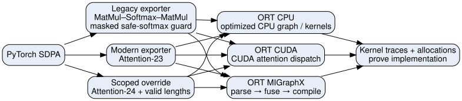

## One equation, several implementations

For query, key, and value tensors, attention computes

\[
S = QK^{T}/\sqrt{d},\qquad P=\operatorname{softmax}(S+M),\qquad O=PV.
\]

Here a boolean mask marks keys that a query may use; its additive equivalent puts zero on allowed keys and negative infinity on blocked keys. We use inference with dropout zero. Padding query outputs are explicitly zeroed, so the compared representations have the same output contract.

A direct implementation stores score/probability tensors with shape `[batch, heads, query_length, key_length]`. Their size grows quadratically with sequence length. FlashAttention-style algorithms tile the computation and maintain the softmax normalization across tiles, avoiding full score/probability tensors in device memory. It is the execution and memory behavior that matters, not whether the serialized model contains a node whose name includes “Attention.” The [rocMLIR attention design](https://github.com/ROCm/rocMLIR/discussions/1076) describes this tiled implementation strategy.

We distinguish three stages of evidence:

1. **ONNX graph:** what was serialized, including casts, masks, optional inputs, shapes, and operator versions.
2. **Runtime graph:** which execution provider claimed the operations and which rewrites it applied.
3. **Kernel trace:** which operations actually ran and whether the full attention intermediate remained in the compiled program.

## Hardware, drivers, and the software actually loaded

<!-- VERSIONS -->

| Recorded component | CPU / NVIDIA environment | AMD environment |
|---|---|---|
| Hardware | AMD EPYC 9534 64-Core Processor; full NVIDIA L40S (sm_89) | AMD EPYC 9534 64-Core Processor; Radeon PRO W7900 (gfx1100) |
| Python | 3.12.15 | 3.12.15 |
| PyTorch | 2.9.1+cu128 | 2.9.1+rocm7.2.1.gitff65f5bc |
| ONNX Runtime | 1.29.0; controls: 1.23.2 | 1.23.2 MIGraphX build |
| NVIDIA driver / AMD module | 590.48.01 | 6.16.13 |
| Host kernel | Linux-6.8.4-200.fc39.x86_64 | Linux-6.8.4-200.fc39.x86_64 |
| PyTorch CUDA / HIP build | 12.8 | 7.2.53211-e1a6bc5663 |
| Runtime API version (raw integer) | 13010 (CUDA driver API) | 70253211 (HIP runtime API) |
| CUDA runtime Python package / ROCm native | nvidia-cuda-runtime-cu12 12.8.90 | ROCm 7.2.4; MIGraphX 2.15.0 |
| cuDNN package / MIOpen build | 9.10.2.21 | MIOpen 3.5.1 (PyTorch build) |
| CUDA actual runtime API | 12080 | HIP API recorded in preceding row |
| Installed toolkit | Build cuda_13.1.r13.1/compiler.37061995_0 | hipconfig --full and ROCm RPM inventory in runtime provenance |
| cuBLAS package | 12.8.4.1 | Native rocBLAS/hipBLASLt package versions in provenance |
| ONNX / NumPy | 1.19.1 / 1.26.4 | 1.19.1 / 1.26.4 |
| Exporter dependencies | ONNX Script 0.5.3 / ONNX IR 0.1.12 | ONNX Script 0.5.3 / ONNX IR 0.1.12 (modern export) |
| Auxiliary C++ runtime | System runtime; exact loaded paths recorded | Conda libstdcxx/libgcc 14.4.0; package builds and hashes in data/cxx-runtime.json |
| CPU compute threads | 1 PyTorch; ORT intra/inter-op 1 | same for reference calculations |

Loaded-library records: [CUDA](data/cuda129/runtime-provenance.json), [MIGraphX](data/rocm-attention/runtime-provenance.json). Full inventories: [NVIDIA](data/cuda129/provenance.json), [CPU](data/cpu129/provenance.json), [AMD default](data/rocm-default/provenance.json), [AMD fusion](data/rocm-attention/provenance.json), and [pod image digests](data/pods.json).

<!-- /VERSIONS -->

The NVIDIA driver version is different from the CUDA version displayed by `nvidia-smi`, which describes driver compatibility. Neither is the same as the CUDA toolkit installed in the container or the runtime bundled with the PyTorch wheel. We record all of them separately. On AMD we likewise preserve the kernel/module information, the driver string returned by ROCm SMI, the ROCm packages, HIP build/runtime versions, and MIGraphX native-library version.

The provenance collector also saves the OS/kernel, CPU model and affinity, full Python package inventory, PyTorch build configuration, cuDNN version, ORT build/provider list, native package inventories, profiler versions, relevant environment switches, and loaded library paths. Pod image digests identify the container image independently of package changes made in `/tmp`.

CUDA and ROCm use PyTorch 2.9.1 builds from their respective vendor stacks. The primary Attention-24 CPU/CUDA results use ORT 1.29; the installed MIGraphX wheel uses ORT 1.23.2. A separate sequence-512 CPU/CUDA control uses ORT 1.23.2 to distinguish version support from hardware differences. Older A100/L40S results are useful historical evidence, but are not silently combined with these new curves.

## What PyTorch SDPA exports

The exporter is part of the experiment. [PyTorch 2.9 documents both the legacy and `torch.export`-based paths](https://docs.pytorch.org/docs/2.9/onnx.html); the latter is selected with `dynamo=True`. We explicitly select MATH while exporting, but this is not an instruction to ONNX Runtime to use a MATH kernel.

### Legacy export: decomposition and hidden precision changes

The legacy exporter produces the familiar pair of MatMul operators around Softmax, with scaling, shape, transpose, and cast operations. The exact artifact is more informative than the abbreviated expression: for the masked FP16 example in this study, the declared output is FP32. “FP16 inputs” therefore does not mean “every operator and output is FP16.” I/O binding must honor the model's declared output type rather than assume it matches Q.

[Unmasked legacy ONNX model](models/sdpa_legacy_fp16_unmasked_b4_s512.onnx) · [text dump](models/sdpa_legacy_fp16_unmasked_b4_s512.txt) · [full graph](figures/graph-sdpa_legacy_fp16_unmasked_b4_s512.svg)

### Masked MATH export: why an IsNaN node appears

If a query cannot attend to any key, all its masked scores are negative infinity. Ordinary softmax then encounters an undefined normalization. The legacy masked MATH export contains a safe-softmax sequence that detects NaN probabilities and replaces them with zeros.

This has a concrete deployment consequence on our MIGraphX stack. An ORT profile identifies `IsNaN` as a CPU node, splitting the surrounding GPU work. The full softmax tensor is copied to the CPU; its boolean NaN mask is copied back. This is not merely cheap CPU preparation of valid lengths. Disabling CPU fallback correctly rejects that execution plan.

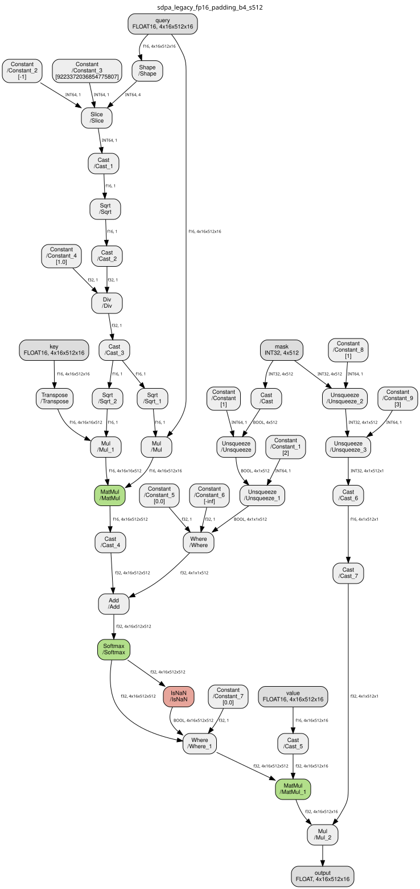

[Masked legacy model](models/sdpa_legacy_fp16_padding_b4_s512.onnx) · [text dump](models/sdpa_legacy_fp16_padding_b4_s512.txt)

### Modern export: Attention-23, not the same graph

With PyTorch 2.9.1, ONNX Script 0.5.3, and compatible ONNX IR 0.1.12, the modern exporter at opset 23 produces a standard ONNX `Attention` node. The unmasked example has one node. This is an observed result for these pinned versions and inputs, not a promise about every PyTorch exporter release or configuration.

Our first attempts encountered an ONNX Script/ONNX IR conversion error; the successful environment and the failed attempts are retained. The default unconstrained ONNX IR installation was incompatible with this exporter configuration.

The raw modern padded export uses a broadcast mask with a singleton query dimension. In the tested ORT 1.29 Attention kernel this fails a query-length shape check. We preserve that raw export and test a second, clearly labeled adaptation that expands the mask to `[B,1,S,S]`. It is mathematically the same mask, but materializing/handling the expanded representation can affect dispatch and memory. It must not be presented as identical serialized input.

[Modern unmasked model](models/sdpa_dynamo_fp16_unmasked_b4_s512.onnx) · [modern text dump](models/sdpa_dynamo_fp16_unmasked_b4_s512.txt) · [adapted padded model](models/sdpa_dynamo_expanded_fp16_padding_b4_s512.onnx)

## Preserving intent with Attention-24

The standard ONNX Attention operator provides a representation of the whole attention operation, including optional mask, past/present state, and valid-key-length inputs. Its schema version matters: Attention-23 and Attention-24 are not interchangeable names for the same input contract. See the [Attention-24 specification](https://onnx.ai/onnx/operators/onnx__Attention.html#attention-24).

The PR #523 [scoped export wrapper snapshot](../../scripts/attention-study/mlpf-onnx-attention.py) calls ordinary PyTorch attention during eager execution. During legacy tracing it emits a typed `mlpf::Attention24` placeholder. The export path then uses ONNX's version converter for the surrounding standard operators, replaces the placeholder with standard-domain `Attention`, and removes the custom-domain import. The final artifact requires no MLPF custom-op library.

We validate that actual wrapper separately from directly constructing minimal ONNX test graphs. The intermediate placeholder and final standard model are included in the evidence bundle. This keeps a controlled runtime experiment distinct from the question of whether the application export override works.

For right-padded batches, valid lengths preserve information that a generic dense mask obscures. The length path uses `nonpad_kv_seqlen` instead of constructing a dense attention mask. The deployment wrapper explicitly rejects empty examples and masks with holes; counting valid keys does not encode arbitrary key positions. Our microbenchmark also probes edge cases to distinguish a kernel's observed behavior from the narrower application contract.

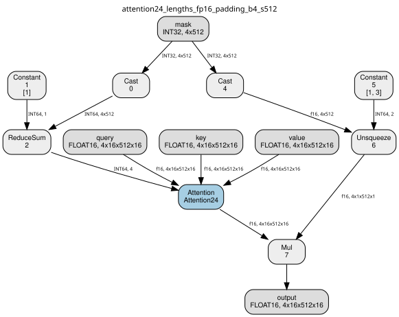

[Attention-24 model](models/attention24_lengths_fp16_padding_b4_s512.onnx) · [text dump](models/attention24_lengths_fp16_padding_b4_s512.txt)

## Removing IsNaN without changing empty-example behavior

Deleting the safe-softmax guard is only valid when the caller guarantees that every query has an allowed key. Multiplying a NaN output by zero afterwards does not repair it.

Our explicit safe decomposition instead detects whether a key set is empty. For an empty set only, it temporarily allows key zero, computes a finite softmax, and then zeros that example's output. Nonempty masks are unchanged. Softmax uses FP32 normalization, while the attention matmuls use the input precision. This retains the intended empty-example behavior without an `IsNaN` operator, assuming finite inputs and finite attention scores.

The core rewrite is:

```python
has_keys = valid.any(dim=-1, keepdim=True)  # valid: [B, 1, 1, S]
first_key = torch.arange(S, device=query.device) == 0
safe_valid = valid | (~has_keys & first_key)
scores = scores.masked_fill(~safe_valid, float("-inf"))
probabilities = scores.float().softmax(dim=-1).to(query.dtype)
output = (probabilities @ value) * has_keys.to(query.dtype)
```

For a nonempty key set, `safe_valid` equals the original mask. For an empty set, the temporary single allowed key makes softmax finite, and multiplication by `has_keys` returns zero. Query-padding outputs are zeroed separately.

The checks include ordinary right padding, an all-padding example, and masks with holes. The resulting graph can execute fully on the tested MIGraphX provider. Whether it also fuses into a single attention kernel is established separately by the compiler dump and kernel trace.

[Safe decomposition model](models/explicit_safe_fp16_padding_b4_s512.onnx) · [text dump](models/explicit_safe_fp16_padding_b4_s512.txt) · [full graph](figures/graph-explicit_safe_fp16_padding_b4_s512.svg)

## What the runtimes do

### CPU

CPUExecutionProvider is a real runtime backend with its own optimizations and attention kernels. It is not just a correctness oracle. The same ONNX files are run on CPU with one intra-op and one inter-op thread; PyTorch also uses one compute thread. The optimized graphs and ORT profiles record whether operations remain decomposed or run as Attention. [Original/optimized node inventories](runtime-graphs.json) and [optimized model dumps](models/optimized/) preserve those transformations. Optimized ORT artifacts may depend on the execution environment and are inspection artifacts, not the shared cross-device inputs.

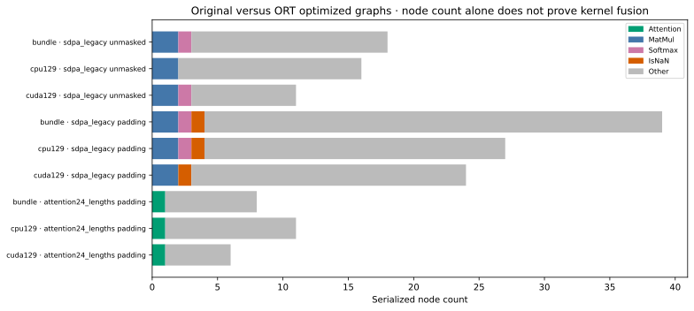

CPU FP16 operator support and internal accumulation should not be equated with GPU FP16 throughput. The CPU curves are a deployment baseline on the recorded host, not a comparison of equivalent peak arithmetic hardware.

### NVIDIA CUDA

CUDAExecutionProvider chooses implementations based on the operator, precision, shapes, masks, and supported kernel controls. A dense mask and a valid-length input can lead to different attention kernels even for equivalent right padding. We use kernel traces to distinguish FlashAttention from an unfused implementation.

In the captured L40S traces, the legacy FP16 decomposition runs separate GEMMs and softmax. Unmasked Attention-24 and Attention-24 with valid lengths dispatch `onnxruntime::flash::flash_fwd_kernel`. Dense masked Attention-24 dispatches a CUTLASS `AttentionKernel` instead, with mask conversion and zero-row handling. These are all GPU executions, but they are not the same algorithm/dispatch path.

This agrees with the [ORT 1.29 Attention dispatch source](https://github.com/microsoft/onnxruntime/blob/v1.29.0/onnxruntime/core/providers/cuda/llm/attention.cc): its FlashAttention eligibility rejects a non-null dense attention mask, while the valid-length path can leave that mask absent. The dense-mask case can use memory-efficient attention. A decomposed graph might fuse under other patterns or graph optimizers; our specific decomposition did not acquire the FlashAttention implementation on this CUDA provider.

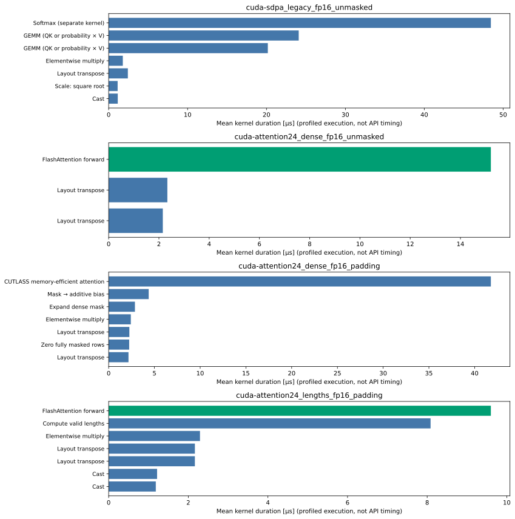

The plot uses profiled kernel durations from three calls and readable labels; full demangled names are retained in [the kernel evidence](cuda-kernel-evidence.json). These durations are explanatory evidence, not replacements for the unprofiled API latency measurements.

The CUDA runtime API also has to match the ORT wheel. In setup, the CUDA-12 ORT 1.29 build could not load with the initial PyTorch CUDA-12.6 runtime: `cudaLibraryGetKernel` was unavailable. The study uses the PyTorch CUDA-12.8 build instead. The driver itself supported both; the incompatibility was in the userspace runtime combination. The [CUDA provider documentation](https://onnxruntime.ai/docs/execution-providers/CUDA-ExecutionProvider.html) explains the separation between provider dependencies and driver compatibility.

### AMD MIGraphX

The ORT MIGraphX provider exports its assigned subgraph to MIGraphX, which parses and compiles it. A graph claimed by MIGraphX is not automatically one fused attention kernel. [The provider compilation path](https://github.com/microsoft/onnxruntime/blob/v1.23.2/onnxruntime/core/providers/migraphx/migraphx_execution_provider.cc) is separate from CUDA's attention dispatch.

On this W7900 stack, ordinary attention fusion is not enabled by default. Request it before starting Python:

```bash
export MIGRAPHX_MLIR_USE_SPECIFIC_OPS=attention
unset MIGRAPHX_DISABLE_MLIR
```

The [ROCm 7.2 architecture gate](https://github.com/ROCm/AMDMIGraphX/blob/rocm-7.2.0/src/targets/gpu/fuse_mlir.cpp#L123) enables this path automatically for `gfx94` and otherwise checks the explicit request. [AMD's tuning guide](https://rocmdocs.amd.com/projects/AMDMIGraphX/en/develop/how-to/model-performance-tuning.html) documents the operation-selection override. This is a compiler environment setting, not a CUDA `sdpa_kernel` provider option. The installed release's flash-decoding split setting is another optimization and is not the switch needed for ordinary attention fusion.

The default and forced cases use separate processes and separate provenance records. The older MIGraphX ORT build rejects our Attention-24 models before execution because its released-opset support ends at 23. For the decomposed FP16 path, the explicit override can produce a single rocMLIR attention kernel with no full score scratch tensor. The safe masked FP16 graph also acquires a fused attention core: its final program has four GPU code objects, covering mask preparation, the attention core, and output masking. The unfused safe graph has six code objects and retains full attention intermediates. “Fused attention” therefore does not mean the whole masked graph must be exactly one kernel.

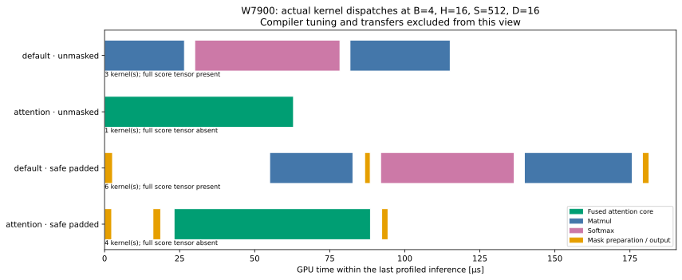

This figure uses the final profiled inference, excluding compiler tuning kernels. The default unmasked program has three code objects and full score tensors; the requested fused unmasked program has one and no full score tensor. The safe padded case removes the full score tensor only when fusion is requested. [Final compiled programs](data/diagnostics/) accompany the raw dispatch names.

FP32 compilation still fails with the fusion request on these tested shapes, while default FP32 decomposition works. Modern Attention-23 also fails on the installed MIGraphX parser with a `num_heads attribute required` error. Loading an opset and correctly interpreting a particular standard Attention schema are separate compatibility questions. These are limitations of this wheel/native-library/shape combination, not evidence that the W7900 cannot perform FP32 or masked attention.

## Measured support and numerical checks

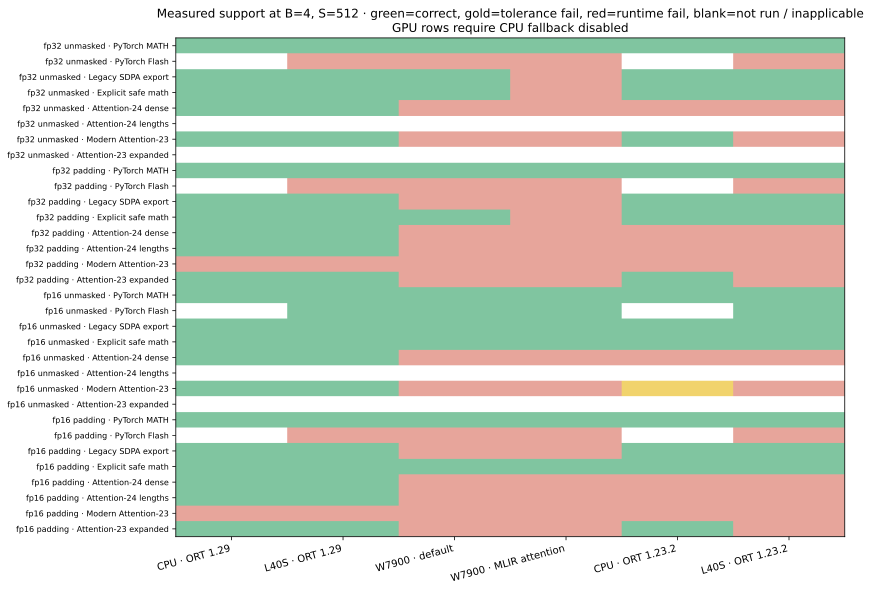

Green means a measured case completed and matched the reference. Gold marks a numerical tolerance failure; red marks a setup/runtime failure. Missing or inapplicable cases are blank. GPU runs in this matrix disable CPU fallback, including CPU placement of dynamic shape computations; that strict policy is stronger than merely requiring the heavy attention computation on GPU. Dynamic probes with fallback allowed explain the actual placement separately.

The reference is PyTorch FP32 MATH on the same inputs after any FP16 quantization. We record mean and maximum absolute error, finiteness, and an elementwise tolerance check. A small mean error alone is not a correctness pass. The comparison uses `atol=rtol=1e-4` for FP32 inputs and `atol=rtol=0.002` for FP16 inputs. Input precision determines the tolerance even if the export declares FP32 output. The tests are numerical checks on synthetic inputs, not a complete proof of equivalence for every possible input.

The version controls found one notable numerical difference: CPU ORT 1.23.2's unmasked FP16 Attention-23 output had maximum absolute error 0.005882, versus 0.000977 in ORT 1.29 for the same canonical model and quantized inputs. Explicitly setting `softmax_precision=FLOAT` did not change either result in the follow-up probe. This identifies a version-dependent numerical outcome without establishing its internal cause; the older result remains a tolerance failure.

The native PyTorch Flash baseline uses the built-in SDPA API with an explicit Flash backend. Its dense-mask cases fail in these builds. That does not establish a hardware limitation on padded FlashAttention: the external packed-variable-length API used in earlier A100/L40S experiments is a different path, and is not installed/tested as a native baseline in these new environments.

A separate small causal test confirms why causal and padding masks should not be conflated. With TF32 disabled, all six representation/precision cases pass on each CPU/CUDA provider. On ROCm, the default decompositions pass; the forced FP16 explicit causal decomposition passes, but the legacy causal FP16 fusion attempt fails. The causal probe is a correctness diagnostic at B=2, H=4, S=128, D=16, not part of the scaling curves. An initial CUDA TF32-default diagnostic is retained separately; the final causal comparison uses the same TF32-off policy as the main sweep.

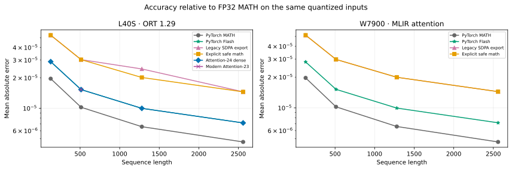

## Performance: keep the API boundary visible

The sequence sweep fixes `B=4`, `H=16`, `D=16` and varies sequence length over 128, 512, 1280, 2560. Padding masks are deterministic and vary in length within the batch. The batch sweep uses balanced right padding so the average valid fraction stays approximately 75% as batch size changes; the sequence sweep at batch 4 has 68.75% valid queries. These are separate workloads, not interchangeable points on one curve. Rounding effects and exact valid-token counts are recorded.

Each timing case has three trials with warmup, with ten measured calls per trial. Figures show the median over all thirty calls and the range of trial medians. These trials share a process/session and therefore do not measure process-to-process variability. Compilation, warmup, profiling, and memory sampling are outside steady-state timing. TF32 matmul is disabled for the CUDA measurements.

ORT host-I/O timing includes transfer from NumPy inputs and transfer back to NumPy outputs. Native PyTorch starts and finishes with tensors on the target device. A separate ORT I/O-binding measurement uses preallocated device inputs and outputs; it includes API and synchronization overhead and is not an isolated kernel timer.

<!-- RESULTS -->

Representative **FP16-input, sequence-2560** medians, in milliseconds. Native PyTorch and ORT bound-I/O share device-resident boundaries; ORT host columns include transfers.

| Backend / representation | Unmasked host/native | Unmasked bound GPU I/O | Padded host/native | Padded bound GPU I/O |
|---|---:|---:|---:|---:|
| cpu129 / pytorch_math | 3274.075 | — | 3320.494 | — |
| cpu129 / sdpa_legacy | 1635.964 | — | 1731.700 | — |
| cpu129 / explicit_safe | 2298.393 | — | 1501.527 | — |
| cpu129 / attention24_dense | 678.856 | — | 539.469 | — |
| cpu129 / attention24_lengths | — | — | 427.766 | — |
| cuda129 / pytorch_math | 23.076 | — | 28.148 | — |
| cuda129 / pytorch_flash_attention | 0.333 | — | failed | — |
| cuda129 / sdpa_legacy | 6.032 | 5.106 | 27.960 | 26.839 |
| cuda129 / explicit_safe | 16.093 | 15.146 | 18.779 | 17.830 |
| cuda129 / attention24_dense | 1.255 | 0.323 | 2.052 | 1.054 |
| cuda129 / attention24_lengths | — | — | 1.219 | 0.263 |
| rocm-default / pytorch_math | 22.870 | — | 27.202 | — |
| rocm-default / pytorch_flash_attention | 1.241 | — | failed | — |
| rocm-default / sdpa_legacy | 5.611 | 5.052 | failed | — |
| rocm-default / explicit_safe | 5.625 | 5.005 | 5.732 | 5.267 |
| rocm-default / attention24_dense | failed | — | failed | — |
| rocm-default / attention24_lengths | — | — | failed | — |
| rocm-attention / pytorch_math | 22.822 | — | 27.152 | — |
| rocm-attention / pytorch_flash_attention | 1.238 | — | failed | — |
| rocm-attention / sdpa_legacy | 2.176 | 1.385 | failed | — |
| rocm-attention / explicit_safe | 2.196 | 1.396 | 2.316 | 1.538 |
| rocm-attention / attention24_dense | failed | — | failed | — |
| rocm-attention / attention24_lengths | — | — | failed | — |

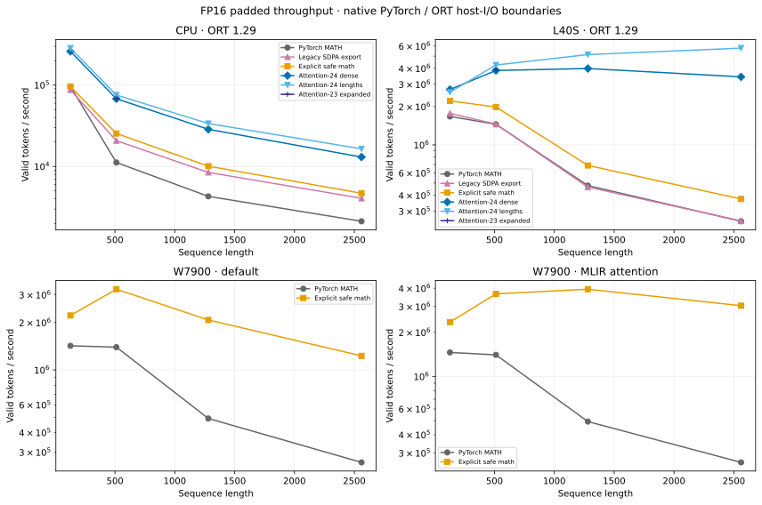

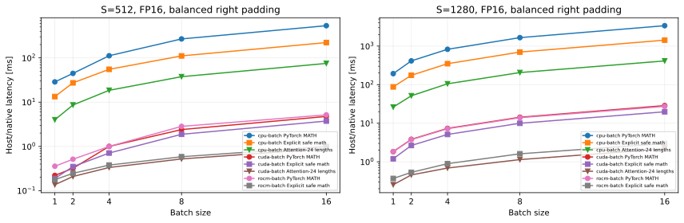

<!-- /RESULTS -->

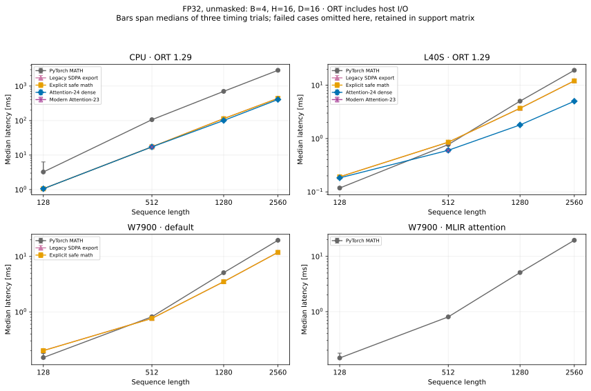

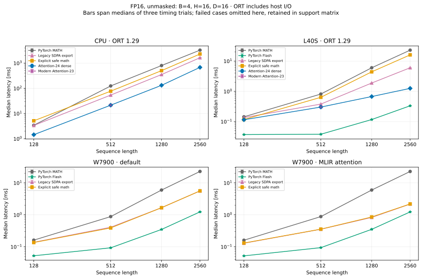

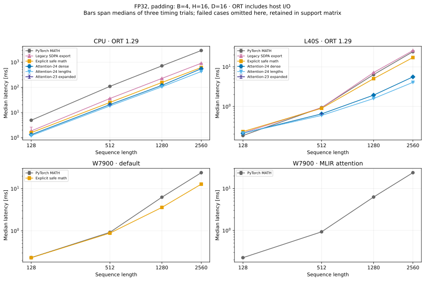

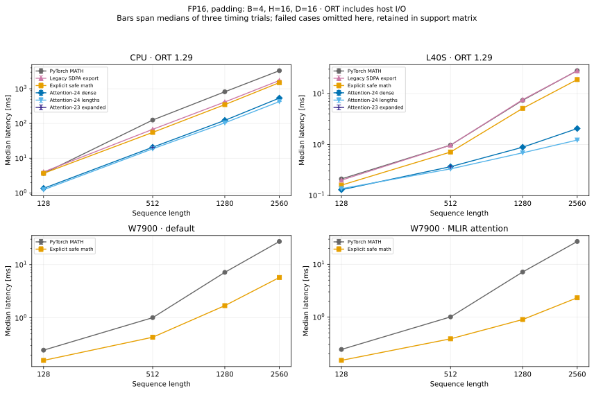

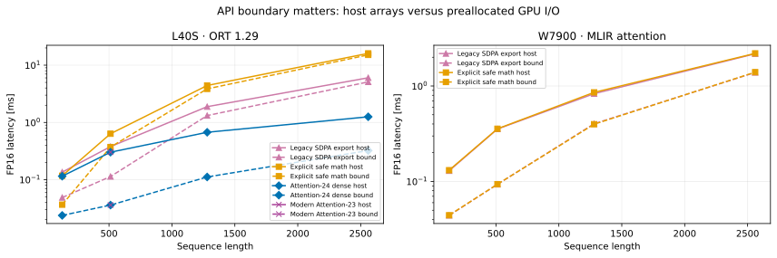

## Memory and changing input sizes

Memory measurements run in separate processes. CPU measurements use process RSS. GPU measurements sample driver-global allocated device memory relative to a pre-session baseline, while using a full GPU with no concurrent study workload. They include provider/context caches and can miss short-lived peaks; they are not PyTorch allocator statistics mislabeled as ORT usage. Compiler scratch shapes and kernel traces provide complementary evidence about full attention-matrix materialization.

<!-- MEMORY -->

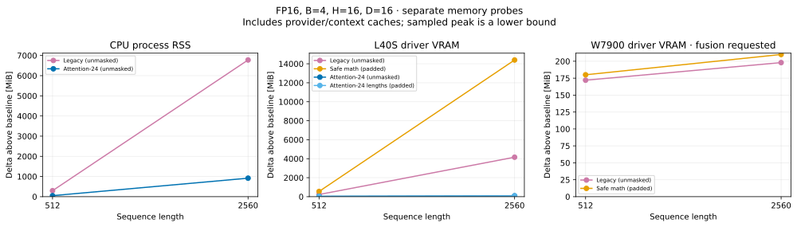

<!-- /MEMORY -->

Symbolic ONNX dimensions describe an input contract, not a guarantee that the GPU compiler emits one shape-polymorphic program. The dynamic experiment calls the same model with `512 → 1280 → 512 → 2560 → 512`, repeats with a new session, and compares MIGraphX disk caching. The profile records CPU shape operations separately from attention compute. Cache entries generated under different compiler settings must not be reused blindly.

<!-- DYNAMIC -->

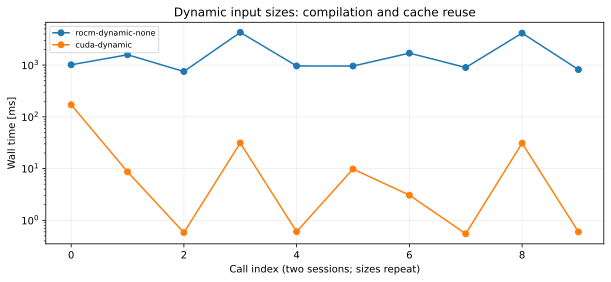

In this MIGraphX no-cache probe, returning to a previously used size still triggered compilation: the provider reused the current specialization, not an in-memory pool of all previously seen shapes. A separate disk-cache probe aborted with a GPU memory-access fault after changing sizes. That result is retained as a failed scenario; this study does not establish reliable disk-cache reuse for the tested wheel/library combination.

<!-- /DYNAMIC -->

## What this means for MLPF export

Prefer an explicit, validated export contract over assuming that a selected PyTorch backend survives serialization. Inspect the model's actual opset, dtypes, mask layout, and output dtype. When valid lengths encode the intended right-padding contract, Attention-24 can preserve a useful optimization opportunity on supporting runtimes. When the runtime cannot load that schema, a decomposed graph may still be compiled into fused attention.

For ROCm, the safe masked decomposition is a useful alternative to CPU fallback, but it must be checked for both correctness and fusion. For CUDA, dense masks and lengths deserve separate measurements. For all providers, distinguish unsupported schema, unsupported graph operation, rejected shape, compilation failure, and numerical failure.

This article validates isolated attention and the repository's scoped export wrapper. It does not substitute these microbenchmark speedups for a trained full-MLPF end-to-end measurement. Existing A100/L40S results and the real model conversion scripts remain useful follow-up checks with a chosen checkpoint and application workload.

## Reproduce and inspect

The article includes curated evidence, representative models and executable sources. Full raw profiling output remains in the local experiment directory. A complete archive can be generated with `scripts/attention-study/package.py`; generated archives are not committed.

The executable study lives in [`scripts/attention-study`](../../scripts/attention-study/). See [reproduction instructions](reproduce.md), [measurements](measurements.csv), and the [evidence index](evidence-index.json). Full raw results, profiles, canonical models, and provenance are saved under `onnx_validation/attention-study/` in the working repository. Representative ONNX models and text dumps are included beside this article so it can be read without that local results directory.

<!-- EVIDENCE -->

Portable data include the [raw measurements](data/cuda129/results.json), [validated classifications](data/cpu129/validated-results.json), [artifact audit](data/audit.json), and full environment records linked above. Numerical reassessment is explicitly marked: initial FP16-input graphs with FP32 outputs were judged against an output-dtype-based tolerance; where the recorded maximum absolute error is at most 0.002, that bound proves the intended FP16-input absolute criterion. Raw measurements and original classifications are preserved.

[ROCm kernel evidence](rocm-kernel-evidence.json) · [CUDA kernel evidence](cuda-kernel-evidence.json) · [dynamic calls](data/diagnostics/rocm-dynamic-none/probe.json) · [cache failure log](data/diagnostics/rocm-dynamic-disk/failure.log).

[FP16 scoped wrapper validation](data/override-demo-fp16/validation.json) · [CUDA execution of the actual wrapper export](data/override-demo-fp16/cuda-proof/probe.json).

[Actual scoped wrapper validation](data/override-demo/validation.json) · [placeholder ONNX](data/override-demo/override-placeholder.onnx) · [standard Attention-24 ONNX](data/override-demo/override-attention24.onnx).

<!-- /EVIDENCE -->

The numerical contract test suite passes in both configured environments: [CUDA environment log](data/cuda-contract-tests.log) and [ROCm environment log](data/rocm-contract-tests.log).
