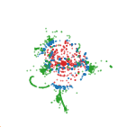
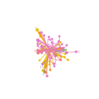

# CLICdet hits

CLICdet hit datasets contain tracker and calorimeter measurements from Key4HEP/EDM4hep production at 380 GeV. The schema version is **3.2.2**, and the standard hit recipe is `pyg-clic-hits-v1`. Hit reconstruction is a research workflow.

## Physics samples

| Physics sample | TFDS dataset | Training selection |
|---|---|---|
| Top-quark pairs | `clic_edm_ttbar_hits` | Included in default recipe |
| Fully hadronic WW | `clic_edm_ww_fullhad_hits` | Included in default recipe |
| Inclusive quark pairs | `clic_edm_qq_hits` | Included in default recipe |

Recipes configure partitions 1--10. The [verified Hub selection](catalog.md#published-availability) provides configuration 1 for `ttbar`, `WW`, and `qq`; check other selections separately.

## Event view

Hits and target particles are shown for a representative `ttbar` event in the transverse plane. Tracker hits are red, ECAL hits blue, HCAL hits green, and muon-system hits orange.

| Raw hits | Target particles |
|:---:|:---:|
|  |  |

## Production and related inputs

Follow [shared Key4HEP production](key4hep.md) through strict Parquet validation, then use `PROD=clic pixi run tfds_hit`. The [hit overview](hit-based.md) explains row targets, placeholder baseline candidates, decoding checks, and memory requirements. Use [CLICdet tracks and clusters](clic.md) for the reconstructed-object representation.
