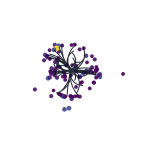

# CLICdet tracks and clusters

CLICdet track/cluster datasets use Key4HEP/EDM4hep production at 380 GeV. The schema version is **3.3.0**, and the standard model recipe is `pyg-clic-v1`.

## Physics samples

| Physics sample | TFDS dataset | Training selection |
|---|---|---|
| Top-quark pairs | `clic_edm_ttbar_pf` | Included in default recipe |
| Fully hadronic WW | `clic_edm_ww_fullhad_pf` | Included in default recipe |
| Inclusive quark pairs | `clic_edm_qq_pf` | Included in default recipe |

The recipes configure partitions 1--10; the [verified public selection](catalog.md#published-availability) provides configuration 1. Use `--data_config 1` for the download-based training path. The default recipe combines `ttbar`, `WW`, and `qq`; their ordering and relative exposure are described in [Dataset mixing](../training/data-mixing.md).

## Event view

Tracks and calorimeter clusters are shown beside the target particles for a
representative `ttbar` event in the transverse plane.

| Tracks and clusters | Target particles |
|:---:|:---:|
|  |  |

Target labels use $e$, $\mu$, $\tau$, $\nu$, $\gamma$, $\pi$, and $K^0$.

## Production and related inputs

Use [shared Key4HEP production](key4hep.md) with `PROD=clic` and build this representation with `pixi run tfds`. For tracker and calorimeter measurements, use the separate [CLICdet hit datasets](clic-hits.md).
